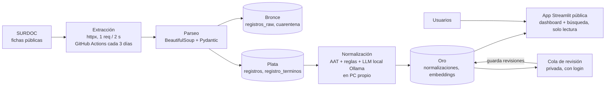

# Observatorio de Colecciones Arqueológicas SURDOC — Documento de diseño técnico

17 de noviembre de 2026 · Matías

## Resumen

El proyecto convierte los registros arqueológicos públicos de SURDOC en un dataset normalizado, consultable y trazable, con un dashboard y búsqueda en lenguaje natural.

- **Problema:** las fichas de SURDOC están dispersas por museo y usan texto libre inconsistente (materiales, técnicas, procedencia), lo que impide compararlas o analizarlas en conjunto.
- **Solución:** un pipeline que extrae, estructura y normaliza esos registros con IA, guardando siempre el valor original junto al normalizado.
- **Objetivo de negocio:** servir como pieza de portafolio frente a consultoras arqueológicas, demostrando el ciclo completo de datos desordenados → IA → información consultable, usando solo datos públicos.
- **Primer corte (MVP):** registros de la clasificación Antropología, Arqueología y Etnografía del Museo Regional de Magallanes.

## Alcance

El MVP cubre un museo y tres campos normalizados; la búsqueda semántica y el resto de los museos entran en sprints posteriores.

|               | Incluido                                                                                                    | Fuera de alcance                                                                                                        |
|---------------|-------------------------------------------------------------------------------------------------------------|-------------------------------------------------------------------------------------------------------------------------|
| Fuente        | Fichas públicas de SURDOC, clasificación arqueológica                                                       | Datos privados de consultoras, SEIA, fichas en papel                                                                    |
| Cobertura     | MVP: Museo Regional de Magallanes. Luego: otros museos regionales                                           | Colecciones de arte e historia                                                                                          |
| Normalización | Tipo de objeto, material y técnica (apoyado en los términos AAT que ya trae SURDOC), estado de conservación | Datación, atribución cultural (requieren criterio experto). Cultura y Área geográfica se guardan, pero no se normalizan |
| Consulta      | Dashboard, búsqueda por filtros, búsqueda semántica (Sprint 4)                                              | Edición pública de registros, API abierta                                                                               |
| Imágenes      | Enlace a la ficha original en SURDOC                                                                        | Descarga o republicación masiva de fotografías                                                                          |
| Ubicación     | Agregación por región o comuna                                                                              | Coordenadas o sitios exactos                                                                                            |

## Actores y casos de uso

Tres actores: el **operador** (nosotros, que ejecuta el pipeline), el **revisor** (quien valida la normalización; idealmente con apoyo de una arqueóloga) y el **usuario de consulta** (consultora, museo o público).

| ID    | Caso de uso                     | Actor                 | Flujo principal                                                                                                                                                                                 | Resultado                                                |
|-------|---------------------------------|-----------------------|-------------------------------------------------------------------------------------------------------------------------------------------------------------------------------------------------|----------------------------------------------------------|
| CU-01 | Extraer registros de un museo   | Operador              | Ejecuta el extractor con el código de institución; el sistema recorre el listado, descarga cada ficha y guarda el HTML parseado                                                                 | Registros en capa raw y staging, con log de ejecución    |
| CU-02 | Actualizar de forma incremental | Operador (programado) | El pipeline compara el hash de los campos parseados de cada ficha (no del HTML, que cambia en cada descarga) y reprocesa solo las que cambiaron; marca como dadas de baja las que ya no existen | Datos al día sin repetir trabajo                         |
| CU-03 | Normalizar campos con IA        | Operador              | El normalizador envía el texto original al LLM local con el vocabulario controlado y guarda valor, confianza y versión del prompt                                                               | Valores normalizados trazables                           |
| CU-04 | Revisar normalizaciones dudosas | Revisor               | Inicia sesión, abre la cola de revisión (confianza baja), compara original vs. propuesto y acepta o corrige                                                                                     | Normalización validada por una persona                   |
| CU-05 | Explorar el dashboard           | Usuario de consulta   | Filtra por museo, tipo de objeto, material, conservación, cultura y área geográfica                                                                                                             | Vista agregada de las colecciones                        |
| CU-06 | Buscar en lenguaje natural      | Usuario de consulta   | Escribe una consulta como "cerámica con decoración incisa"; el sistema devuelve fichas similares con enlace a SURDOC                                                                            | Resultados relevantes sin conocer la terminología exacta |

## Requisitos

### Funcionales

- **RF-01** Extraer todos los registros de una institución y clasificación dadas, usando los filtros del buscador de SURDOC.
- **RF-02** Guardar cada ficha en bruto (campos parseados + hash de esos campos) antes de transformarla.
- **RF-03** Extraer el texto y el ID AAT de Objeto, Técnica y Material, y normalizar tipo de objeto, material/técnica y estado de conservación contra un vocabulario basado en el AAT.
- **RF-04** Conservar siempre el valor original junto al normalizado, incluidos los campos con varios valores.
- **RF-05** Enviar a revisión manual todo valor con confianza bajo el umbral calibrado.
- **RF-06** Mostrar un dashboard con filtros por museo, tipo, material, conservación, cultura y área geográfica.
- **RF-07** Permitir búsqueda semántica en lenguaje natural (Sprint 4).
- **RF-08** Enlazar cada resultado a su ficha original en SURDOC.
- **RF-09** Enviar a una tabla de cuarentena las fichas que fallen al parsear, sin detener el lote.
- **RF-10** Marcar como dadas de baja las fichas que desaparezcan de SURDOC, sin borrarlas.

### No funcionales

- **RNF-01 Respeto a la fuente:** respetar `robots.txt`, máximo 1 solicitud cada 2 segundos, User-Agent identificable y reintentos con espera creciente.
- **RNF-02 Idempotencia:** volver a ejecutar el pipeline no duplica datos.
- **RNF-03 Trazabilidad:** cada valor normalizado indica el original, el ID AAT si existe, el modelo, la versión del prompt y si fue revisado por una persona.
- **RNF-04 Reproducibilidad:** todo el entorno corre con un comando (Docker) y la configuración vive en variables de entorno.
- **RNF-05 Costo:** sin costos externos. Infraestructura en planes gratuitos y modelo de lenguaje local (Ollama); se mide el tiempo de normalización por corrida desde el Sprint 2.
- **RNF-06 Seguridad:** claves solo en variables de entorno o secretos (GitHub, Streamlit), nunca en el repositorio. La cola de revisión exige inicio de sesión y la escritura en la base está protegida con RLS.
- **RNF-07 Calidad:** pruebas automáticas del parser con fichas HTML de ejemplo y un set de referencia para el normalizador.
- **RNF-08 Monitoreo:** si una ejecución programada falla, llega un aviso por correo.

## Arquitectura

Un pipeline por lotes escribe en tres capas de datos (bronce, plata y oro) dentro de una sola base PostgreSQL, y una app de Streamlit las consulta.

Cada etapa del pipeline escribe su propia capa: el dato extraído nunca se sobrescribe, y lo que corrige el revisor vuelve a la capa oro con su autoría registrada.

- **Lotes, no tiempo real:** SURDOC cambia poco, así que una extracción incremental cada 3 días basta, respeta la fuente y evita la pausa de Supabase por inactividad (7 días).
- **IA local, sin costo externo:** la normalización y los embeddings corren en un computador propio con modelos abiertos (Ollama y sentence-transformers). Toman de la base los registros pendientes, de forma manual o programada. Ningún dato sale a un servicio de pago.
- **Una sola base de datos:** datos tabulares y vectores en Postgres con pgvector, sin un servicio aparte para búsqueda.
- **Separación de capas:** permite reprocesar una etapa (por ejemplo, un prompt o modelo nuevo) sin volver a descargar nada.
- **Consulta pública, revisión privada:** el dashboard y la búsqueda son públicos y solo leen; la cola de revisión exige inicio de sesión y es lo único que escribe en la capa oro.
- **Modelo intercambiable:** el modelo de lenguaje se define en una variable de entorno. Si más adelante un cliente lo justifica, se puede cambiar a una API de pago sin tocar el resto del código.

## Stack tecnológico

Todo el stack es Python sobre PostgreSQL, en planes gratuitos, y reutiliza lo construido en el proyecto del Museo de Magallanes.

| Capa                 | Herramienta                                                                                                                                    | Por qué                                                                                                                                 |
|----------------------|------------------------------------------------------------------------------------------------------------------------------------------------|-----------------------------------------------------------------------------------------------------------------------------------------|
| Lenguaje             | Python 3.12, dependencias con uv                                                                                                               | Dominio previo y scraper existente; instalación reproducible                                                                            |
| Extracción           | httpx + BeautifulSoup                                                                                                                          | Se reutiliza la lógica del scraper de Magallanes                                                                                        |
| Validación           | Pydantic                                                                                                                                       | Esquema tipado de cada ficha; errores detectados al parsear                                                                             |
| Base de datos        | PostgreSQL en Supabase + extensión pgvector, con RLS                                                                                           | Ya conocido; datos y vectores en una sola base; lectura pública y escritura restringida                                                 |
| Vocabulario          | Términos AAT en español que ya enlaza SURDOC                                                                                                   | Vocabulario reconocido por la disciplina; menos trabajo para el LLM                                                                     |
| Normalización        | Ollama con un modelo abierto multilingüe, corriendo en un computador propio; modelo configurable por variable de entorno                       | Sin costo externo y sin enviar datos afuera; el modelo exacto se elige en el Sprint 0 según calidad y velocidad en el equipo disponible |
| Embeddings           | Modelo multilingüe pequeño (sentence-transformers), el mismo en el pipeline y en la app                                                        | Sin costo por consulta; debe caber en la memoria del plan gratuito de Streamlit (a verificar en el Sprint 4)                            |
| Dashboard y búsqueda | Streamlit + Plotly en Streamlit Community Cloud, solo lectura                                                                                  | Despliegue gratuito y fácil de compartir                                                                                                |
| Cola de revisión     | Página de Streamlit con inicio de sesión (Supabase Auth)                                                                                       | Solo el revisor autenticado puede escribir                                                                                              |
| Orquestación         | Extracción en GitHub Actions cada 3 días, con aviso por correo si falla; normalización y embeddings en el computador propio, manual o con cron | Gratis; mantiene activa la base de Supabase; la IA no necesita servidores pagados                                                       |
| Entorno              | Docker + docker compose (Postgres y Ollama locales para desarrollo)                                                                            | Reproducible con un comando                                                                                                             |
| Calidad              | pytest + ruff                                                                                                                                  | Pruebas del parser y del normalizador, y estilo consistente                                                                             |

Alternativa para el dashboard: Power BI conectado a Postgres, útil como práctica para la certificación PL-300, pero menos fácil de compartir públicamente.

## Modelo de datos

Once tablas organizadas en capas: lo extraído en bruto nunca se modifica, y cada transformación queda en su propia tabla. (Ajustado en el Sprint 0 tras analizar las 77 fichas reales; ver `docs/sprint0.md`.)

| Tabla               | Capa       | Clave                                              | Campos principales                                                                                                                                                                                                                                                             |
|---------------------|------------|----------------------------------------------------|--------------------------------------------------------------------------------------------------------------------------------------------------------------------------------------------------------------------------------------------------------------------------------|
| `museos`            | Referencia | `id`                                               | nombre, código de institución en SURDOC (ej. 16 = Magallanes), región, comuna                                                                                                                                                                                                  |
| `registros_raw`     | Bronce     | `surdoc_id`                                        | url, campos parseados (jsonb, incluye datos no publicables como el nombre de sitio), hash de los campos parseados, fecha de extracción, fecha de última vez vista. Privada                                                                                                     |
| `cuarentena`        | Bronce     | `surdoc_id` + `fecha`                              | url, error de parseo, HTML guardado para depurar                                                                                                                                                                                                                               |
| `registros`         | Plata      | `surdoc_id`                                        | museo_id, título, n.º de inventario, clasificación, colección, objeto, descripción, dimensiones, técnica/material, procedencia, cultura originaria, cultura arqueológica, área cultural, área geográfica, fecha de creación, creador, forma de ingreso, estado de conservación, url de imagen, crédito de la imagen, dado de baja (sí/no). Sin nombre de sitio |
| `registro_terminos` | Plata      | `surdoc_id` + `campo` + `orden`                    | campo (objeto, nombre_alternativo, tecnica, material), texto original, fuente del término (`aat` o `tesauro_regional`) e ID del término, si la ficha lo enlaza. Una fila por valor; `orden` es correlativo por campo y `grupo` indica a qué par técnica-material pertenece (un par puede traer varios materiales) |
| `vocabulario`       | Referencia | `campo` + `fuente_termino` + `id_termino`          | término preferido, sinónimos, término padre, categoría del observatorio                                                                                                                                                                                                        |
| `normalizaciones`   | Oro        | `surdoc_id` + `campo` + `orden` + `version_prompt` | valor normalizado, método (regla AAT, sinónimo o LLM), confianza (0–1), modelo, fecha                                                                                                                                                                                          |
| `revisores`         | Referencia | `usuario_id`                                       | uid de Supabase Auth y nombre de cada persona autorizada a revisar. Privada; RLS solo deja insertar revisiones a quien está aquí                                                                                                                                                |
| `revisiones`        | Oro        | `id`                                               | surdoc_id, campo, orden, valor anterior, valor corregido, revisado por, fecha                                                                                                                                                                                                  |
| `embeddings`        | Oro        | `surdoc_id` + `modelo`                             | vector (pgvector), texto usado para generarlo                                                                                                                                                                                                                                  |
| `ejecuciones`       | Auditoría  | `id`                                               | tipo de proceso, inicio, fin, registros procesados, en cuarentena, dados de baja, errores, versión del código                                                                                                                                                                  |

Una vista `valor_vigente` entrega el valor final de cada campo: si existe una revisión humana, gana siempre; si no, se usa la normalización de la última versión de prompt. Así, cambiar el prompt nunca borra el trabajo del revisor.

La tabla `ejecuciones` deja un registro auditable de cada corrida del pipeline: qué se procesó, cuándo y con qué versión.

## Normalización con IA

La IA propone, una persona valida lo dudoso, y todo queda registrado: así el dataset es confiable frente a arqueólogos.

1.  **Vocabulario basado en el AAT.** SURDOC enlaza Objeto, Técnica y Material a términos del AAT en español (por ejemplo `aatespanol.cl/terminos/300039757`) o del Tesauro Regional Patrimonial (`tesauroregional.cl/terminos/384`). En Magallanes, el 53 % de las fichas no trae Técnica / Material y el material solo aparece en la descripción (ver `docs/sprint0.md`). El vocabulario del observatorio agrupa esos términos en categorías comparables (cerámica, lítico, óseo, metal, textil, malacológico, etc.) usando la jerarquía del AAT.
2.  **Reglas antes que IA.** Primero se normaliza por ID AAT; luego por coincidencia exacta o sinónimo. Solo lo que queda sin resolver va al LLM local. Así se reduce el tiempo de proceso y la variabilidad.
3.  **Varios valores por campo.** Cada valor de un campo (por ejemplo, tres materiales) se normaliza por separado y se guarda con su número de orden.
4.  **Salida estructurada.** El LLM responde en JSON con `valor`, `confianza` y `justificación`, validado con Pydantic. Solo puede elegir del vocabulario u "otro". Si el JSON no es válido, se reintenta una vez y luego se envía a revisión.
5.  **Umbral calibrado.** Se parte con un umbral de 0,8, pero la confianza que reporta el LLM no es confiable por sí sola: en el Sprint 2 se ajusta comparándola con la muestra revisada a mano. Todo valor bajo el umbral o marcado como "otro" entra a la cola de revisión.
6.  **Las revisiones humanas mandan.** Las correcciones se guardan en `revisiones` y prevalecen sobre cualquier versión de prompt, presente o futura.
7.  **Versionado.** Cada prompt tiene una versión. Si cambia, se normaliza de nuevo sin borrar los resultados anteriores, lo que permite comparar versiones.
8.  **Medición de calidad.** Se revisa una muestra aleatoria de 50 valores por campo, idealmente con una arqueóloga, y se calcula el porcentaje de aciertos por método (regla AAT, sinónimo, LLM). Ese número se publica en el README como evidencia.

No se normalizan datación ni atribución cultural en el MVP: exigen criterio experto y un error ahí dañaría la credibilidad del proyecto.

## Estructura del repositorio y convenciones

Un solo repositorio con un módulo por etapa del pipeline y una app de Streamlit separada.

    observatorio-surdoc/
    ├── pipeline/
    │   ├── extract/        # listado y descarga de fichas SURDOC
    │   ├── parse/          # HTML → modelo Pydantic
    │   ├── normalize/      # reglas + LLM + vocabulario
    │   ├── embed/          # generación de embeddings
    │   └── run.py          # punto de entrada: python -m pipeline.run --museo 16
    ├── app/                # Streamlit: dashboard, búsqueda y cola de revisión
    ├── db/migrations/      # SQL versionado
    ├── vocab/              # vocabularios controlados en CSV
    ├── prompts/            # prompts versionados (v1, v2…)
    ├── tests/fixtures/     # fichas HTML de ejemplo para pruebas
    ├── scripts/            # utilidades fuera del pipeline (ej. comparar modelos de Ollama)
    ├── docs/               # hallazgos por sprint (sprint0.md…)
    ├── .github/workflows/  # ejecución programada y pruebas
    ├── docker-compose.yml
    └── .env.example

**Convenciones:**

- Ramas por historia (`feat/…`, `fix/…`) y pull request hacia `main`, aunque trabajemos solos: deja historial revisable.
- Commits con prefijo convencional (`feat:`, `fix:`, `docs:`).
- Toda configuración por variables de entorno; `.env.example` documenta cada una.
- Cada sprint termina con una etiqueta de versión (`v0.1`, `v0.2`…).

## Plan por sprints

Seis sprints de una semana, de 5 a 12 horas cada uno (unas 40 a 62 horas en total); el MVP mostrable queda listo al cierre del Sprint 3.

| Sprint | Objetivo                     | Entregables                                                                                                                                                                                                                                                                                   | Criterio de aceptación                                                                                                                                                                           | Horas aprox. |
|--------|------------------------------|-----------------------------------------------------------------------------------------------------------------------------------------------------------------------------------------------------------------------------------------------------------------------------------------------|--------------------------------------------------------------------------------------------------------------------------------------------------------------------------------------------------|--------------|
| 0      | Preparación y descubrimiento | Repositorio, Docker, Supabase con RLS, migraciones iniciales; revisión de `robots.txt` y términos de uso; confirmar cómo pagina el buscador de SURDOC con los filtros de clasificación (548) e institución (16); instalar Ollama y probar dos o tres modelos abiertos en el computador propio | `docker compose up` levanta Postgres local; documento con las URLs de listado, la paginación y el total de registros arqueológicos de Magallanes; modelo local elegido según calidad y velocidad | 5–8          |
| 1      | Extracción                   | Extractor + parser con Pydantic; capas bronce y plata; tabla de términos con IDs AAT; cuarentena; bajas; tabla de ejecuciones; pruebas con fichas de ejemplo                                                                                                                                  | Registros cargados = total informado por SURDOC (menos los en cuarentena, que quedan listados); re-ejecutar no duplica; pruebas en verde                                                         | 8–12         |
| 2      | Normalización                | Vocabulario basado en el AAT; reglas por ID y sinónimo; normalizador con LLM local vía Ollama y salida JSON; tiempo medido por corrida                                                                                                                                                        | Tres campos normalizados sin costo externo; muestra de 50 por campo revisada; aciertos por método documentados; umbral calibrado                                                                 | 8–12         |
| 3      | Dashboard y revisión (MVP)   | App Streamlit pública de solo lectura con filtros y gráficos; cola de revisión con inicio de sesión; vista `valor_vigente`; despliegue                                                                                                                                                        | URL pública funcionando; sin sesión no se puede escribir; una corrección del revisor sobrevive a una nueva versión de prompt                                                                     | 8–12         |
| 4      | Búsqueda semántica           | Embeddings con pgvector usando un modelo pequeño; búsqueda en lenguaje natural en la app                                                                                                                                                                                                      | La app desplegada carga el modelo sin exceder la memoria; diez consultas de prueba devuelven resultados pertinentes en los primeros cinco                                                        | 6–10         |
| 5      | Escala y portafolio          | Dos o tres museos regionales más; extracción cada 3 días en GitHub Actions con aviso de fallas; normalización local programada con cron; README con arquitectura y métricas                                                                                                                   | Pipeline corre solo; una falla genera aviso; README listo para mostrar a consultoras                                                                                                             | 5–8          |

## Riesgos y mitigaciones

El riesgo principal está en la fuente: si SURDOC no permite filtrar bien o cambia su HTML, el resto del plan se atrasa.

| Riesgo                                                | Impacto                                                                     | Mitigación                                                                                                                                                |
|-------------------------------------------------------|-----------------------------------------------------------------------------|-----------------------------------------------------------------------------------------------------------------------------------------------------------|
| SURDOC no permite listar por museo y clasificación    | Medio (bajó: el buscador ya expone filtros por clasificación e institución) | Confirmar la paginación en el Sprint 0; alternativa: recorrer el buscador por términos                                                                    |
| Cambios en el HTML de SURDOC rompen el parser         | Medio                                                                       | Pruebas con fichas guardadas; cuarentena; aviso si la ejecución falla                                                                                     |
| Bloqueo por exceso de solicitudes                     | Medio                                                                       | `robots.txt`, 1 solicitud cada 2 segundos, ejecución incremental                                                                                          |
| Normalización con errores                             | Alto para la credibilidad                                                   | Vocabulario AAT, reglas antes que IA, umbral calibrado, revisión humana y métrica publicada                                                               |
| El modelo local acierta menos que un servicio de pago | Medio                                                                       | La mayoría de los casos se resuelve con AAT y reglas; lo dudoso va a revisión humana; el modelo es intercambiable si la calidad no alcanza                |
| El computador propio es lento o no está encendido     | Medio                                                                       | Probar velocidad en el Sprint 0; usar un modelo pequeño; la normalización procesa pendientes cuando el equipo esté disponible, sin bloquear la extracción |
| Escritura no autorizada en la base                    | Alto                                                                        | Cola de revisión con inicio de sesión; RLS en Supabase; la app pública solo lee                                                                           |
| El modelo de embeddings no cabe en Streamlit Cloud    | Medio                                                                       | Elegir un modelo pequeño y probarlo desplegado al inicio del Sprint 4                                                                                     |
| Pausa de Supabase por inactividad                     | Bajo                                                                        | Extracción cada 3 días, bajo el límite de 7 días                                                                                                          |

## Consideraciones legales y éticas

- **Términos de uso y `robots.txt` de SURDOC:** se revisan en el Sprint 0, antes de cualquier extracción masiva. Si restringen la reutilización, se ajusta el alcance.
- **Fotografías:** no se descargan ni republican. Si la app muestra una miniatura, la carga desde SURDOC con el crédito del fotógrafo que trae la ficha y enlaza al original.
- **Atribución:** cada registro muestra su fuente (SURDOC y la institución) y enlaza al original.
- **Protección de sitios:** las ubicaciones se agregan por región, comuna o área geográfica; nunca se publican coordenadas ni sitios exactos.
- **Datos generados por IA:** la app distingue visualmente los valores revisados por una persona de los propuestos por el modelo.

## Decisiones pendientes

- [ ] ¿Dashboard en Streamlit, en Power BI o ambos?
- [ ] ¿Qué museos se suman en el Sprint 5, además de Magallanes?
- [ ] ¿Podemos contar con la arqueóloga para validar el vocabulario y la muestra de revisión?
- [ ] ¿El repositorio será público desde el inicio o solo al cerrar el MVP?
- [ ] ¿Qué categorías del observatorio agrupan los términos AAT? Conviene definirlas con la arqueóloga.
- [x] ¿Qué modelo local se usa? **`gemma2:2b`**: 9/10 aciertos y 0,8 s por valor en la GPU del PC propio (comparado con qwen2.5:3b y llama3.2:3b; ver `docs/sprint0.md`).
