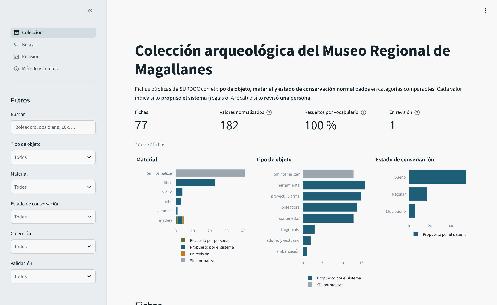
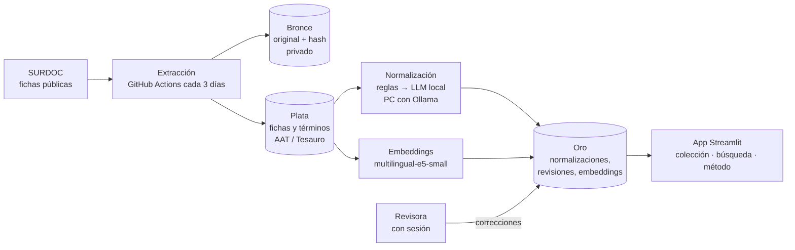

# Observatorio de Colecciones Arqueológicas SURDOC

Convierte las fichas arqueológicas públicas de [SURDOC](https://www.surdoc.cl), el sistema de registro de colecciones de los museos del Estado de Chile, en un dataset **normalizado, consultable y trazable**: un pipeline extrae las fichas, las estructura, normaliza sus campos con vocabularios controlados e IA local, y las expone en una app con búsqueda en lenguaje natural y revisión humana.

El objetivo es demostrar, con datos públicos reales, el ciclo completo **datos desordenados → IA → información confiable**, pensado para el trabajo de consultoras arqueológicas: trazabilidad de cada valor, revisión por personas y métricas de calidad publicadas.



*Panel con las 77 fichas del Museo Regional de Magallanes. La captura muestra los valores resueltos por el vocabulario; los marcados como "Sin normalizar" esperan la corrida del modelo local.*

## Qué resuelve

Las fichas de SURDOC están escritas en texto libre y cada museo registra distinto: en Magallanes, **41 de 77 fichas no declaran su material** (está solo en la descripción), los objetos enlazan a dos vocabularios distintos (AAT en español y Tesauro Regional) y hay errores reales, como un fragmento cerámico registrado con material "Madera". Así no se pueden comparar ni analizar.

El observatorio:

1. **Extrae** las fichas respetando el sitio (una solicitud cada 2 s, `robots.txt`, User-Agent identificable) y guarda el original intacto.
2. **Normaliza** tipo de objeto, material/técnica y estado de conservación con **reglas primero** (ID del AAT o del Tesauro, sinónimos) y un **modelo de lenguaje local** solo para lo que queda.
3. **Manda a revisión humana** lo dudoso: confianza baja, "otro" o contradicción con la descripción. Las correcciones prevalecen sobre cualquier versión futura del modelo.
4. **Publica** una app con filtros, gráficos, búsqueda por significado y el origen de cada valor (original, método, modelo, versión de prompt, confianza).

## Resultados medidos

| Qué | Resultado |
|---|---|
| Extracción | 77 de 77 fichas, 0 en cuarentena; repetir la extracción no duplica ni reescribe nada (detección de cambios por hash de los campos) |
| Normalización sin IA | 182 de 236 valores (77 %) resueltos por vocabulario; los 54 restantes van al modelo local |
| Modelo local (Ollama) | `gemma2:2b`: 9 de 10 aciertos en la prueba inicial, 0,8 s por valor en GPU, sin costo ni envío de datos a terceros |
| Búsqueda en lenguaje natural | 10 de 10 consultas de prueba con resultados pertinentes entre los 5 primeros (precisión@5: 0,68), con `multilingual-e5-small` |
| Precisión por método | Se publica al completar la revisión humana de una muestra de 50 valores por campo |

Cada cifra viene de una corrida documentada en `docs/sprint*.md`.

## Arquitectura



Todo vive en una sola base PostgreSQL en Supabase (con pgvector). Las capas separan lo extraído de lo transformado: se puede cambiar el prompt o el modelo y reprocesar sin volver a descargar nada, y comparar versiones.

**Seguridad.** Row Level Security en todas las tablas: el público solo lee; la app pública solo tiene la clave anónima; únicamente una revisora autenticada y registrada puede guardar correcciones, y la base las firma con su usuario. La capa bronce, que puede contener nombres de sitios, es privada.

**Protección del patrimonio.** No se publican coordenadas ni nombres de sitios arqueológicos, y el texto indexado para la búsqueda solo usa campos públicos. Las fotografías no se copian: se muestran desde SURDOC con el crédito del fotógrafo y cada ficha enlaza a su original.

## Stack

Python 3.12 · uv · httpx + BeautifulSoup · Pydantic · PostgreSQL (Supabase) + pgvector + RLS · Ollama (`gemma2:2b`) · sentence-transformers (`intfloat/multilingual-e5-small`, PyTorch CPU) · Streamlit + Plotly · GitHub Actions · pytest + ruff · Docker Compose.

Todo en planes gratuitos y modelos abiertos: **sin costos externos**. El modelo de lenguaje se cambia con una variable de entorno si un cliente quiere más calidad con una API de pago.

## Ejecutar en local

Requisitos: Docker, [uv](https://docs.astral.sh/uv/) y, para la normalización con IA, [Ollama](https://ollama.com).

```bash
cp .env.example .env
docker compose up -d                                    # Postgres + pgvector con las migraciones
uv sync --group embed                                   # dependencias (Python 3.12)

uv run python -m pipeline.run --museo 16                # extrae las 77 fichas (~3 min)
ollama pull gemma2:2b
uv run python -m pipeline.normalize correr              # reglas + LLM local
uv run --group embed python -m pipeline.embed generar   # embeddings para la búsqueda
uv run --group embed streamlit run app/app.py           # app

uv run ruff check . && uv run pytest                    # 125 pruebas
```

Calidad: `python -m pipeline.normalize muestra --campo material` exporta una muestra para revisión humana y `python -m pipeline.normalize metricas revision/*.csv` calcula los aciertos por método y el umbral de confianza. `python -m pipeline.embed evaluar` mide la búsqueda con `evaluacion/consultas_busqueda.csv`.

## Operación

| Proceso | Dónde | Cuándo |
|---|---|---|
| Extracción (`pipeline.run --todos`) | GitHub Actions (`.github/workflows/extraccion.yml`) | Cada 3 días; falla y avisa por correo si no puede leer SURDOC o si más del 20 % de las fichas cae en cuarentena (señal de que cambió el HTML) |
| Normalización y embeddings | PC propio (`scripts/procesar_pendientes.ps1`) | Diario con el Programador de tareas de Windows; solo procesa lo pendiente |
| App | Streamlit Community Cloud | Siempre disponible |

Para sumar un museo basta con agregarlo a la tabla `museos`: la extracción programada recorre todos.

## Estado

| Sprint | Objetivo | Estado |
|---|---|---|
| 0 | Preparación y descubrimiento | ✅ [docs/sprint0.md](docs/sprint0.md) |
| 1 | Extracción | ✅ [docs/sprint1.md](docs/sprint1.md) |
| 2 | Normalización | Código listo; falta la revisión humana de la muestra ([docs/sprint2.md](docs/sprint2.md)) |
| 3 | App con revisión (MVP) | Lista; falta desplegarla ([docs/sprint3.md](docs/sprint3.md)) |
| 4 | Búsqueda semántica | ✅ [docs/sprint4.md](docs/sprint4.md) |
| 5 | Escala y portafolio | Automatización lista; museos adicionales por definir ([docs/sprint5.md](docs/sprint5.md)) |

Diseño técnico: [`DISENO_TECNICO.md`](DISENO_TECNICO.md) · Contexto y reglas del proyecto: [`CLAUDE.md`](CLAUDE.md)

## Fuente y atribución

Datos de SURDOC (Servicio Nacional del Patrimonio Cultural) y de cada institución. Cada registro enlaza a su ficha original. Proyecto independiente, sin afiliación con SURDOC ni con los museos.
