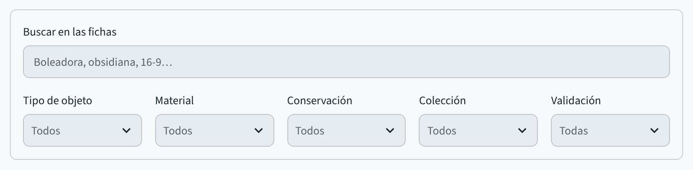
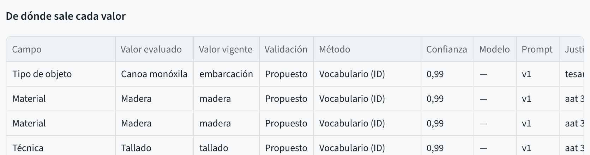
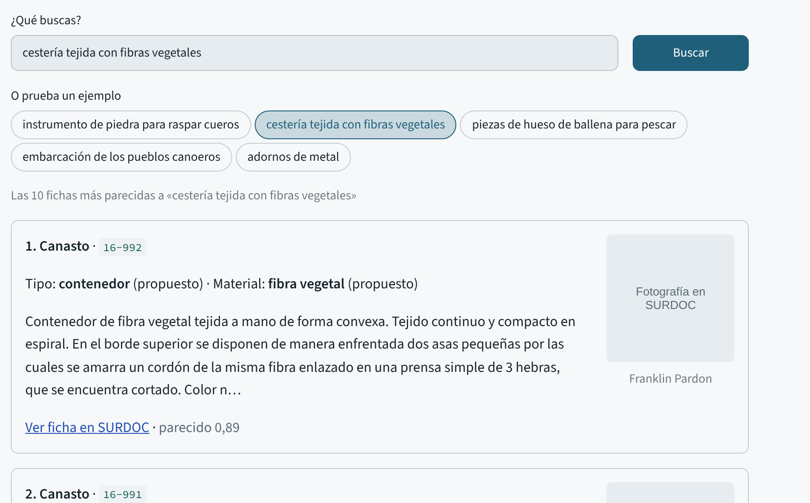
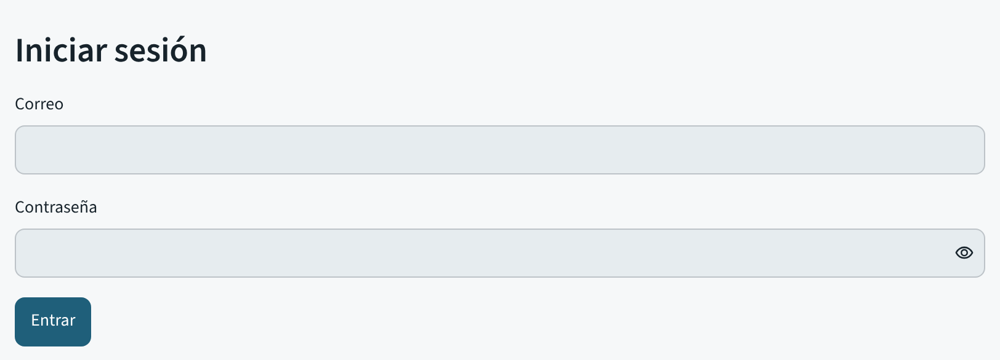
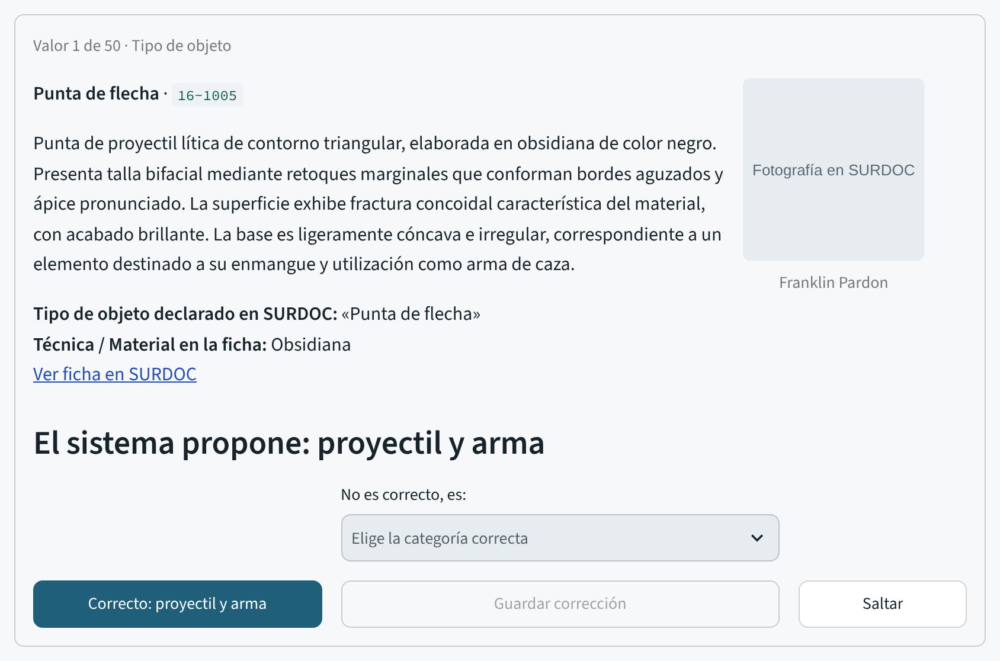

# Guía de uso

El Observatorio reúne las fichas arqueológicas públicas del Museo Regional de Magallanes que están en [SURDOC](https://www.surdoc.cl) y ordena tres datos de cada pieza (tipo de objeto, material y estado de conservación) en categorías que se pueden comparar. Así puedes ver, por ejemplo, cuántas piezas de la colección son líticas o encontrar todos los objetos de hueso, aunque cada ficha los haya descrito con palabras distintas.

No necesitas crear una cuenta para explorar ni para buscar. Solo las personas que revisan los datos inician sesión.

## Lo esencial en un minuto

- **Colección** muestra todas las fichas con gráficos y una tabla. Usa los filtros para acotar y haz clic en una fila para ver el detalle.
- **Buscar** encuentra fichas a partir de una frase normal, como "cestería tejida con fibras vegetales".
- **Método y fuentes** explica de dónde vienen los datos y cuánto acierta el sistema.
- Cada ficha tiene un enlace a su registro original en SURDOC, que siempre es la fuente oficial.

## Qué significa cada estado

Junto a cada valor ordenado verás uno de estos estados. Te dicen cuánto puedes confiar en él.

| Estado | Qué significa |
|---|---|
| **Revisado** | Una persona lo validó. Es el valor más confiable. |
| **Propuesto** | Lo asignó el sistema con confianza suficiente: casi siempre a partir del vocabulario que ya trae la ficha (AAT o Tesauro Regional) y, en menos casos, con un modelo de lenguaje. |
| **En revisión** | El sistema no está seguro, no encontró una categoría ("otro") o lo declarado en SURDOC contradice la descripción. Una persona lo va a revisar. |
| **Sin normalizar** | Todavía no se ha procesado. |

Los datos de cultura, área geográfica y datación se muestran tal como vienen de SURDOC: no se ordenan porque requieren criterio experto.

## Explorar la colección

1. **Filtra.** Escribe una palabra en *Buscar en las fichas* (por ejemplo, "boleadora" o el número de registro "16-919") o elige valores en los filtros de tipo, material, conservación, colección o validación. Puedes combinar varios.
2. **Lee los gráficos.** Cada barra cuenta fichas y su color indica el estado: la parte naranja son valores en revisión. "otro" y "Sin normalizar" aparecen siempre al final, porque no son categorías sino la falta de una.
3. **Abre una ficha.** Haz clic en una fila de la tabla. Debajo aparecen la descripción, los datos de inventario, la fotografía (cargada desde SURDOC, con el crédito de quien la tomó) y el botón **Ver ficha original en SURDOC**.
4. **Comprueba de dónde sale cada valor.** La tabla *De dónde sale cada valor* muestra, para cada dato, lo que dice la ficha original, el valor que se usa, su estado y cómo se obtuvo.

> **Consejo:** si un filtro deja la página vacía, aparece un aviso. Quita alguno de los filtros para volver a ver resultados.

## Buscar con tus palabras

1. Escribe lo que buscas en *¿Qué buscas?* y pulsa **Buscar**, o elige uno de los ejemplos.
2. Verás las 10 fichas más parecidas a tu frase, de la más a la menos parecida, con su tipo, material, un extracto de la descripción y el enlace a SURDOC.

**Para obtener mejores resultados:**

- Describe la pieza como lo harías en voz alta: material, uso, forma o técnica ("punta de piedra tallada", "recipiente de vidrio").
- No necesitas el término exacto del catálogo: la búsqueda compara significados, no palabras.
- El número de *parecido* (de 0 a 1) solo sirve para ordenar. No indica si el resultado es correcto; revisa la descripción o la ficha original.

La primera búsqueda puede tardar unos segundos mientras se prepara el modelo; las siguientes son inmediatas.

## Para revisoras y revisores

Esta parte es solo para las personas autorizadas a validar datos. Cada decisión queda firmada con tu usuario y **prevalece sobre cualquier versión futura del sistema**.

### Entrar

Abre **Revisión**, escribe tu correo y tu contraseña y pulsa **Entrar**. Si no tienes cuenta, pídela a quien administra el Observatorio: no hay registro abierto.

### Muestra de calidad

Es una selección **al azar** de valores (50 de material y 50 de tipo de objeto) que sirve para medir cuánto acierta el sistema. Con tus respuestas se publica la precisión en *Método y fuentes*.

Para cada tarjeta:

1. Lee la descripción, lo que declara SURDOC y, si hace falta, la ficha original.
2. Si la propuesta es correcta, pulsa **Correcto**.
3. Si no lo es, elige la categoría correcta en *No es correcto, es:* y pulsa **Guardar corrección**.
4. Si tienes dudas, pulsa **Saltar** y vuelve después.

Tu avance se guarda solo: puedes cerrar la página y seguir otro día. Revisar los 100 valores toma unos 20–30 minutos.

> **¿Por qué no se muestra la confianza del sistema?** Para no influir en tu respuesta. Por la misma razón nada viene marcado de antemano: cada valor necesita tu decisión.

### Cola de revisión

Reúne los valores que el sistema marcó como dudosos. Cada tarjeta explica por qué está ahí (por ejemplo, "Lo declarado en SURDOC no calza con la descripción, que sugiere cerámica"). Elige el valor correcto en la lista y pulsa **Guardar revisión**; si la propuesta ya era correcta, guárdala igual para dejarla validada.

## Método y fuentes

Esta página explica cómo se extraen y ordenan los datos, cuántos valores se resolvieron con el vocabulario y cuántos con el modelo de lenguaje, y —cuando avanza la revisión de la muestra— la **precisión medida por personas** para cada método. Es la página para compartir con quien quiera saber cuánto confiar en los datos.

## Preguntas frecuentes

**¿Puedo confiar en los datos?**
Los valores **Revisados** fueron validados por una persona. Los **Propuestos** vienen en su mayoría del vocabulario que ya trae cada ficha. La precisión real de cada método se publica en *Método y fuentes*. Ante cualquier duda, la ficha original en SURDOC es la fuente oficial.

**¿Por qué algunas piezas dicen "otro"?**
El sistema no encontró una categoría que calce con la ficha. Esos valores quedan en revisión para que una persona los asigne.

**¿Por qué no aparece el sitio donde se encontró una pieza?**
Para proteger los sitios arqueológicos, el Observatorio nunca publica coordenadas ni nombres de sitios.

**¿Las fotografías son del Observatorio?**
No. Se muestran directamente desde SURDOC, con el crédito de quien las tomó, y cada una enlaza a su ficha original.

**¿Cada cuánto se actualizan los datos?**
Las fichas se vuelven a leer desde SURDOC cada pocos días. Si una ficha cambia en SURDOC, sus valores se vuelven a ordenar.

## Si algo no funciona

| Lo que ves | Qué hacer |
|---|---|
| "No pudimos conectar con la base de datos" | Espera unos segundos y pulsa **Reintentar**. |
| "La búsqueda no está disponible en este momento" | Intenta de nuevo en unos minutos o usa los filtros de **Colección**. |
| "Ninguna ficha coincide con estos filtros" | Quita alguno de los filtros. |
| "Correo o contraseña incorrectos" | Revisa los datos; si persiste, pide a quien administra que verifique tu cuenta. |
| "Tu usuario no está autorizado como revisor" | Tu cuenta existe pero no tiene permiso para revisar: pide que te autoricen. |

---

Datos: [SURDOC](https://www.surdoc.cl), Servicio Nacional del Patrimonio Cultural, y Museo Regional de Magallanes. El Observatorio es un proyecto independiente, sin afiliación con SURDOC ni con el museo.
